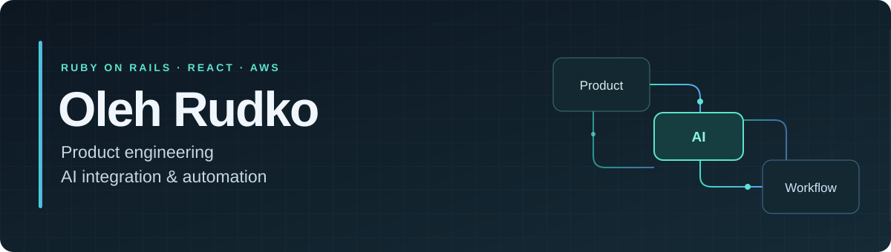

# Hi, I'm Oleh.

I'm a software engineer and team lead based in Bali. I build SaaS products, experiment with AI, and write about how it changes the way people learn and work.

What interests me most is being able to start something unfamiliar, learn what I need along the way, and turn that learning into something that works.

## My AI vision

AI makes it easier to approach tasks that once felt out of reach. You can begin with a question, discover what you are missing, and build understanding through a real task.

I see domain expertise and AI growing together. Experience helps me ask better questions and judge the result. AI helps me explore what I don't know yet. The useful part is what I can actually do with that combination.

I wrote **My AI Vision Today** to explain this view, including learning through practice, choosing how much to delegate, and keeping sight of the original goal.

**[Read my AI vision in English](https://oleh-rudko.github.io/ai-vision/ai-en.html) · [Українською](https://oleh-rudko.github.io/ai-vision/ai-ua.html)**

## How I approach the work

- **Stay open to a different approach.** I reconsider familiar workflows when new tools give me a better way to handle the task.
- **Learn through practice.** I try an idea on a concrete problem, observe what happens, and use that experience to improve the next attempt.
- **Preserve progress.** When something falls short, I look for the cause and change the relevant part while keeping what already works.
- **Check the outcome.** I want evidence that the result fits the real situation. I match AI's autonomy to the task and my ability to verify it.

These ideas also shape how I mentor teammates and organize AI-assisted engineering work.

## Things I build

My day-to-day work is at **AcuityPPM**, where I've helped build portfolio-management software since July 2020. I work across the application and lead a team while staying hands-on. My work includes AI assistants grounded in product data, integrations and operational automation.

Other projects let me apply the same curiosity to different problems:

- **[ENEN School](https://enenschool.com).** A school website and a learning assistant connecting n8n, Notion and Telegram, with scheduled assignments and submissions for teachers.
- **AI translation.** A customer-used web app combining Soniox transcription, Ollama Cloud translation and domain vocabulary for a confidential client.
- **Code review experiments.** A Discord bot using OpenClaw, Ollama and ChatGPT to coordinate reviews and communicate findings.
- **[AI Vision](https://github.com/Oleh-Rudko/ai-vision).** My public guide to working with AI, with English and Ukrainian versions.

My usual tools include **Ruby on Rails, React, TypeScript, PostgreSQL, GraphQL and AWS**, alongside Bedrock, Ollama Cloud and n8n.

## Away from the task

I use Neovim and keep my [editor configuration](https://github.com/Oleh-Rudko/nvim-lua) here. Outside software, I enjoy guitar, piano, singing and reading the Bible.

Based in **Bali, Indonesia · UTC+8**. Remote collaboration across EU and US time zones by agreement.

**[LinkedIn](https://www.linkedin.com/in/oleh-r-940a68197/) · [Email](mailto:oleg.rudko0906@gmail.com) · [Telegram](https://t.me/olegusR)**
